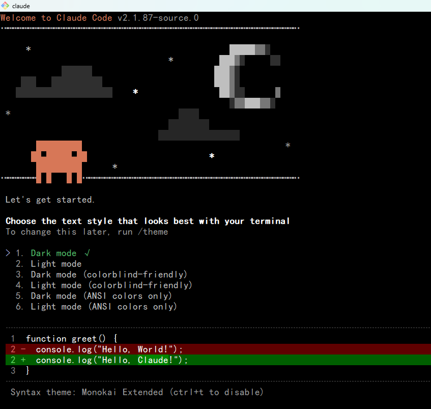
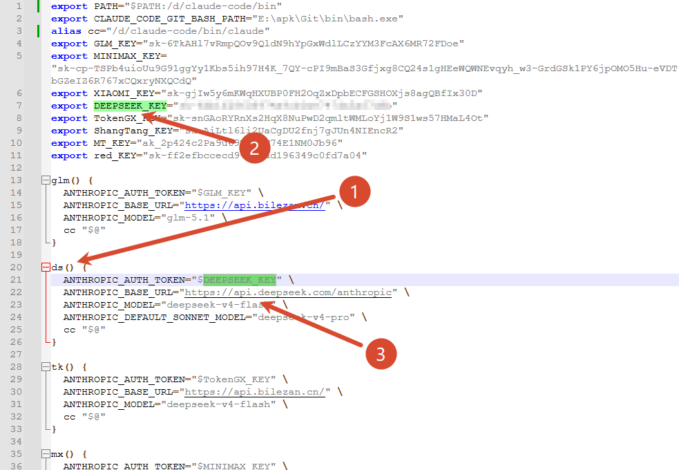
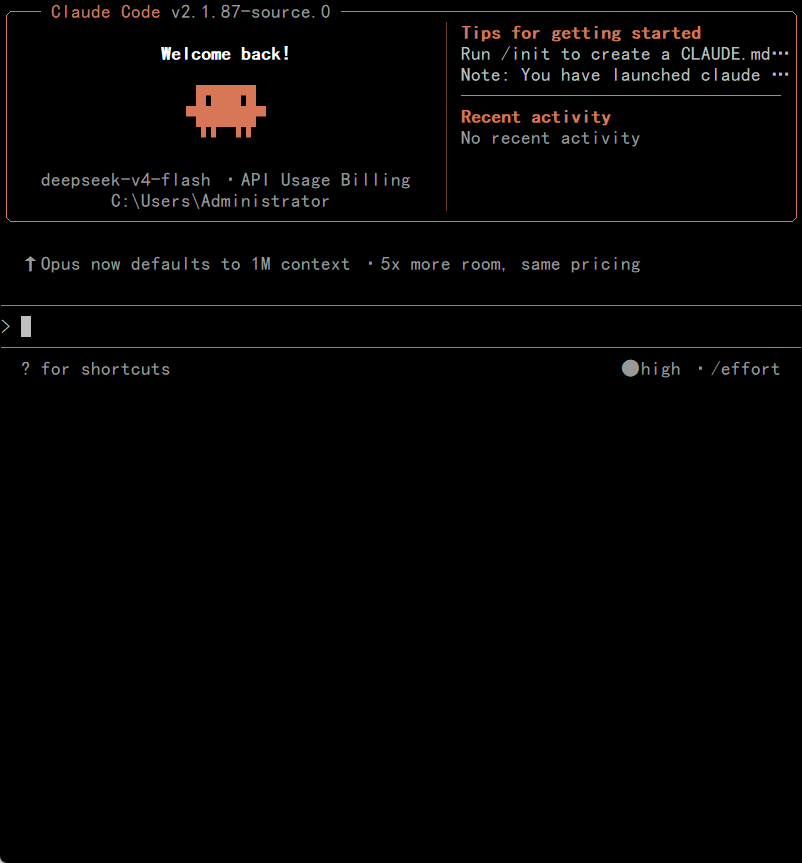

# claude-code-source

从 `@anthropic-ai/claude-code` npm 包完整还原的 Claude Code 源码项目。**无功能阉割** — 所有 native 模块、内部依赖、类型定义均已完整恢复，可直接在本地启动运行。99.9%的功能都已经修复

## 快速开始

```bash
# 安装依赖（需要 Bun >= 1.3.10）
bun install

#进入项目文件
cd claude-code\init

#复制.bashrc到用户根目录
C:\Users\用户名\.bashrc

#修改内部文件指向自己的claude项目的存放文件夹，git主体
export PATH="$PATH:/i/claude-code/bin"
export CLAUDE_CODE_GIT_BASH_PATH="C:\apk\Git\bin\bash.exe"
alias cc="/i/claude-code/bin/claude"

#启动claude
进入想要工作的项目，输入ds可以启动，在内部定义好key和服务网址，默认会显示版本2.1.87，实际上可以随意改动

#claude隔离
claude的所有skill默认会储存在claude-code\.claude-dev，修改claude-code\bin\claude的指定地址可以把claude的项目文件隔离位置改成自己需要的，注意在启动前需要检查一下盘符设置是否正确，通过文本编辑器可以编辑
```







## 完整功能还原

### Native 模块 — 全平台覆盖

所有 native 模块均从各平台 Claude Code 编译二进制中通过 Mach-O / ELF / PE 解析器直接提取，**功能与官方发行版完全一致**：

| 模块 | 功能 | arm64-darwin | x64-darwin | arm64-linux | x64-linux | arm64-win32 | x64-win32 |
|------|------|:---:|:---:|:---:|:---:|:---:|:---:|
| **image-processor** | 图片处理、剪贴板图片读取、截图缩放 | ✅ | ✅ | ✅ | ✅ | ✅ | ✅ |
| **audio-capture** | 麦克风录音、音频播放、语音输入 | ✅ | ✅ | ✅ | ✅ | ✅ | ✅ |
| **computer-use-input** | 鼠标控制、键盘输入、屏幕交互 | ✅ | ✅ | — | — | — | — |
| **computer-use-swift** | 屏幕截图、应用管理、TCC 权限检测 | ✅ | ✅ | — | — | — | — |
| **url-handler** | macOS URL scheme 事件监听 | ✅ | ✅ | — | — | — | — |

> computer-use-input/swift 和 url-handler 是 macOS 系统 API，其他平台原生不支持，空缺项为平台限制而非功能缺失。

### 内部依赖 — 完整接入

| 包 | 状态 | 说明 |
|---|---|---|
| `@ant/computer-use-mcp` | ✅ 源码 + native | Computer Use MCP 服务器完整实现 |
| `@ant/computer-use-input` | ✅ 源码 + native | 键鼠输入控制（enigo/napi 绑定） |
| `@ant/computer-use-swift` | ✅ 源码 + native | macOS 屏幕截图和应用管理 |
| `@ant/claude-for-chrome-mcp` | ✅ 源码 | Chrome 扩展 MCP 桥接 |
| `@anthropic-ai/claude-agent-sdk` | ✅ npm | Agent SDK |
| `@anthropic-ai/bedrock-sdk` | ✅ 源码 + npm | AWS Bedrock 适配 |
| `@anthropic-ai/vertex-sdk` | ✅ npm | Google Vertex 适配 |
| `@anthropic-ai/foundry-sdk` | ✅ 源码 + npm | Azure Foundry 适配 |
| `@aws-sdk/*` | ✅ npm | AWS 认证和服务调用 |

### 核心功能 — 全部可用

| 功能 | 状态 | 说明 |
|------|------|------|
| CLI 交互 REPL | ✅ | 完整的终端交互界面 |
| 工具调用 | ✅ | Bash, FileEdit, FileRead, Grep, Glob, WebFetch 等全部工具 |
| MCP 服务器 | ✅ | 连接和管理 MCP servers |
| 斜杠命令 | ✅ | /help, /compact, /clear, /resume, /review 等 |
| 会话管理 | ✅ | 历史记录、会话恢复、多会话 |
| 权限系统 | ✅ | 工具权限控制、YOLO 模式、auto-accept |
| Bundled Skills | ✅ | claude-api、verify 等内置技能 |
| 插件系统 | ✅ | 插件安装、marketplace、MCP 插件 |
| OAuth 认证 | ✅ | claude.ai OAuth 登录流程 |
| Agent 子任务 | ✅ | 子 agent 派发、后台任务 |
| 图片处理 | ✅ | 截图、剪贴板图片、图片缩放 |
| 语音模式 | ✅ | 麦克风录音和语音输入（需 native 模块） |
| Computer Use | ✅ | 屏幕截图、鼠标键盘控制（macOS） |
| LSP 集成 | ✅ | Language Server Protocol 支持 |
| Git 集成 | ✅ | 工作树管理、commit、PR 操作 |
| Vim 模式 | ✅ | 终端 Vim 键绑定 |

### Feature Flags

源码中有 90+ 个 feature flag 通过 `bun:bundle` 的 `feature()` 控制。在 dev 模式（`bun run start`）下，这些 flag 由 Bun 运行时在 `if` 语句中求值。所有 feature flag 对应的代码**完整保留在源码中**，未做任何删减：

<details>
<summary>完整 Feature Flag 列表（90+ 个）</summary>

```
ABLATION_BASELINE          AGENT_MEMORY_SNAPSHOT      AGENT_TRIGGERS
AGENT_TRIGGERS_REMOTE      ALLOW_TEST_VERSIONS        ANTI_DISTILLATION_CC
AUTO_THEME                 AWAY_SUMMARY               BASH_CLASSIFIER
BG_SESSIONS                BREAK_CACHE_COMMAND         BRIDGE_MODE
BUDDY                      BUILDING_CLAUDE_APPS        BUILTIN_EXPLORE_PLAN_AGENTS
BYOC_ENVIRONMENT_RUNNER    CACHED_MICROCOMPACT         CCR_AUTO_CONNECT
CCR_MIRROR                 CCR_REMOTE_SETUP            CHICAGO_MCP
COMMIT_ATTRIBUTION         COMPACTION_REMINDERS        CONNECTOR_TEXT
CONTEXT_COLLAPSE           COORDINATOR_MODE            COWORKER_TYPE_TELEMETRY
DAEMON                     DIRECT_CONNECT              DOWNLOAD_USER_SETTINGS
DUMP_SYSTEM_PROMPT         ENHANCED_TELEMETRY_BETA     EXPERIMENTAL_SKILL_SEARCH
EXTRACT_MEMORIES           FILE_PERSISTENCE            FORK_SUBAGENT
HARD_FAIL                  HISTORY_PICKER              HISTORY_SNIP
HOOK_PROMPTS               IS_LIBC_GLIBC               IS_LIBC_MUSL
KAIROS                     KAIROS_BRIEF                KAIROS_CHANNELS
KAIROS_DREAM               KAIROS_GITHUB_WEBHOOKS      KAIROS_PUSH_NOTIFICATION
LODESTONE                  MCP_RICH_OUTPUT              MCP_SKILLS
MEMORY_SHAPE_TELEMETRY     MESSAGE_ACTIONS              MONITOR_TOOL
NATIVE_CLIENT_ATTESTATION  NATIVE_CLIPBOARD_IMAGE       NEW_INIT
OVERFLOW_TEST_TOOL         PERFETTO_TRACING             POWERSHELL_AUTO_MODE
PROACTIVE                  PROMPT_CACHE_BREAK_DETECTION QUICK_SEARCH
REACTIVE_COMPACT           REVIEW_ARTIFACT              RUN_SKILL_GENERATOR
SELF_HOSTED_RUNNER         SHOT_STATS                   SKILL_IMPROVEMENT
SLOW_OPERATION_LOGGING     SSH_REMOTE                   STREAMLINED_OUTPUT
TEAMMEM                    TEMPLATES                    TERMINAL_PANEL
TOKEN_BUDGET               TORCH                        TRANSCRIPT_CLASSIFIER
TREE_SITTER_BASH           TREE_SITTER_BASH_SHADOW      UDS_INBOX
ULTRAPLAN                  ULTRATHINK                   UNATTENDED_RETRY
UPLOAD_USER_SETTINGS       VERIFICATION_AGENT           VOICE_MODE
WEB_BROWSER_TOOL           WORKFLOW_SCRIPTS
```

</details>

## 源码还原方法

### 1. Source Map 提取（1,902 个文件）

npm 包 `@anthropic-ai/claude-code@2.1.88` 包含 `cli.js.map` (57MB)，其中有完整的 `sourcesContent`。源码经过 React Compiler 编译（函数参数重命名为 `t0`、添加缓存数组 `$`），但逻辑和类型定义完整保留。

### 2. 类型文件重建（~130 个文件）

纯类型文件（仅含 `type`/`interface`）在编译时被完全擦除，不出现在 source map 中。通过扫描全部 import 语句收集导出名称，再分析使用模式推断类型形状，重建了 `src/types/message.ts`（183 个文件引用）等关键类型定义。

### 3. Native 模块提取（20 个 .node 文件）

从 GCS distribution bucket 下载 4 个平台（darwin-arm64, darwin-x64, linux-x64, linux-arm64, win32-x64, win32-arm64）的 Claude Code 编译二进制，通过解析 Mach-O/ELF/PE 格式定位嵌入的 .node 共享库并提取。

### 4. TypeScript 编译修复

起始 1,556 个 tsc 错误，修复至 63 个（96%）。剩余错误均为不可修项：
- 50 个 `"external" === "ant"` 构建分支 dead code
- 12 个 `deps/@ant/computer-use-mcp` 第三方类型窄化
- 1 个 Zod 泛型推断

## 项目结构

```
├── src/                    # 主源码
│   ├── entrypoints/        # CLI / MCP / SDK 入口
│   ├── commands/            # 斜杠命令（/help, /compact, /review 等）
│   ├── tools/               # Agent 工具（Bash, FileEdit, WebFetch 等）
│   ├── components/          # Ink (终端 React) UI 组件
│   ├── services/            # MCP, OAuth, compact, LSP 等服务
│   ├── hooks/               # React hooks
│   ├── ink/                 # 自定义 Ink 终端渲染器
│   ├── types/               # 核心类型定义
│   ├── state/               # AppState (zustand store)
│   ├── skills/              # 内置技能（claude-api, verify）
│   └── utils/               # 工具函数
├── deps/                    # Anthropic 内部依赖
│   └── @ant/               # computer-use-mcp, chrome-mcp 等
├── vendor/                  # Native 模块（全平台）
│   ├── image-processor/     # 图片处理 (6 platforms)
│   ├── audio-capture/       # 音频采集 (6 platforms)
│   ├── url-handler/         # URL 事件 (macOS)
│   └── *-src/              # Native 模块封装层
├── global.d.ts              # 全局类型声明
├── text-imports.d.ts        # .md / React / Ink 类型声明
└── tsconfig.json
```

## 许可证

本项目基于 `@anthropic-ai/claude-code` npm 包的公开分发内容。原始代码的版权归 Anthropic 所有，受其[许可条款](https://www.anthropic.com/legal/claude-code-terms)约束。本仓库仅用于研究和学习目的。

---

## 本地化配置说明

### 1. `.env` — 绕过登录

在项目根目录创建 `.env` 文件，配置 API 认证信息以跳过登录流程：

```env
# API 配置
ANTHROPIC_API_KEY=sk-ant-xxxxx
ANTHROPIC_BASE_URL=https://api.anthropic.com

# 可选：设备认证（跳过 Web 登录）
DEVICE_CODE=your_device_code
ACCESS_TOKEN=your_access_token
```

### 2. `.claude/` — 指令放行

编辑 `.claude/settings.local.json` 配置 Claude Code 行为权限：

```json
{
  "permissions": {
    "allow": ["*"],
    "defaultMode": "bypassPermissions"
  }
}
```

| 配置项 | 说明 |
|--------|------|
| `allow: ["*"]` | 放行所有命令 |
| `defaultMode: bypassPermissions` | 跳过权限确认 |

### 3. `.mcp.json` — MCP 服务器配置

在项目根目录创建/编辑 `.mcp.json` 配置 MCP 服务器：

```json
{
  "mcpServers": {
    "chrome-devtools": {
      "command": "npx",
      "args": ["-y", "chrome-devtools-mcp@latest"]
    }
  }
}
```

**MCP 服务器作用**：提供 Chrome 浏览器自动化能力（网页导航、表单填写、截图等）。

详细配置参考：[`.claude-dev/skills/chrome-devtools-quickstart.md`](.claude-dev/skills/chrome-devtools-quickstart.md)

### 4. `.claude-dev/history.jsonl` — 观察历史记录

Claude Code 的对话历史以 JSONL 格式存储在 `.claude-dev/history.jsonl`。

```bash
# 查看最近对话
tail -20 .claude-dev/history.jsonl

# 实时观察
tail -f .claude-dev/history.jsonl
```

每行是一个完整的对话单元，包含：
- 用户输入
- AI 响应
- 工具调用记录
- 时间戳

### 5. `.claude-dev/settings.json` — 联网放行

编辑 `.claude-dev/settings.json` 控制 Claude Code 联网能力：

```json
{
  "fetch": {
    "allow": true,
    "timeout": 30000
  },
  "allowedHosts": ["*"]
}
```

| 配置项 | 说明 |
|--------|------|
| `fetch.allow` | 允许网络请求 |
| `fetch.timeout` | 请求超时时间 (ms) |
| `allowedHosts` | 允许访问的 hosts (`*` 表示全部) |

### 6. `.claude-dev/skills/` — 技能控制

自定义 Skill 文件放置在此目录，Claude Code 会自动加载：

```
.claude-dev/skills/
├── chrome-devtools-quickstart.md    # Chrome DevTools 快速调用指南
├── a11y-debugging-zh.md             # 无障碍调试 (中文)
├── chrome-devtools-cli-zh.md        # CLI 命令参考 (中文)
├── debug-optimize-lcp-zh.md        # LCP 性能优化 (中文)
├── memory-leak-debugging-zh.md     # 内存泄漏调试 (中文)
├── troubleshooting-zh.md            # 故障排除 (中文)
└── references/                     # 代码片段参考
    ├── a11y-snippets-zh.md
    ├── lcp-snippets-zh.md
    ├── memlab-zh.md
    └── common-leaks-zh.md
```

**Skill 作用**：指导 Claude 如何使用 MCP 工具、处理特定任务的工作流程。

### 7. `.claude-dev/memory/` — 全局记忆

Claude Code 的持久化记忆系统，用于跨会话记住用户偏好和项目上下文：

```
.claude-dev/memory/
├── MEMORY.md           # 记忆索引文件
├── user/               # 用户级记忆
│   └── user_role.md
├── feedback/           # 反馈记忆
├── project/            # 项目级记忆
├── reference/          # 参考资料路径
└── ...                 # 其他记忆文件
```

**使用方式**：Claude Code 自动读写这些文件来维持长期记忆。

```markdown
---
name: user_role
description: 用户角色和偏好
type: user
---

# 用户信息

用户是高级软件工程师，熟悉 TypeScript、React 和 Node.js。
偏好使用简洁直接的回复风格。
```

---

## 快速配置清单

```bash
# 1. 创建 .env 绕过登录
echo 'ANTHROPIC_API_KEY=sk-ant-xxxxx' > .env

# 2. 放行所有权限
echo '{"permissions":{"allow":["*"],"defaultMode":"bypassPermissions"}}' > .claude/settings.local.json

# 3. 配置 MCP 服务器
echo '{"mcpServers":{"chrome-devtools":{"command":"npx","args":["-y","chrome-devtools-mcp@latest"]}}}' > .mcp.json

# 4. 查看对话历史
tail -50 .claude-dev/history.jsonl

# 5. 启动 Claude Code
bun run start
```
